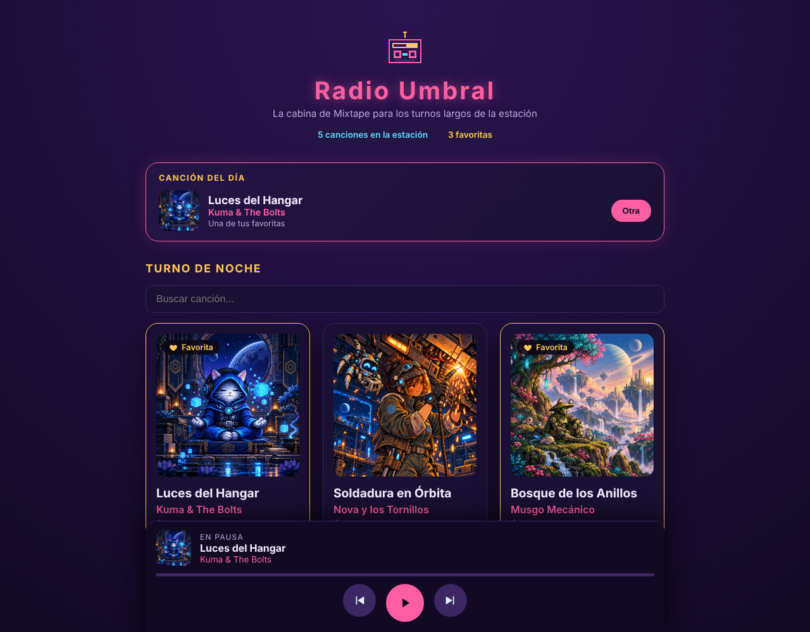

# Radio Umbral · Mixtape 4.0

**Temática:** synthwave nocturno. Una cabina de radio en la Estación Umbral, con violeta de noche, rosa neón y dorado.

Es la respuesta sugerida de la Lección 4 completa: el ejercicio en clase (Operación Cola, MIX-401) y el proyecto de cierre del Módulo 1 (Inauguración de la cabina, MIX-402). Tu cabina no tiene que parecerse a esta: el nombre, el logo, los colores y tu componente son tuyos. Úsala para ver cómo se resuelve cada ticket o como checkpoint si te atrasaste.



**Despliegue:** ENLACE PENDIENTE (aquí va el enlace de Vercel).

## Cómo arrancarla

```bash
pnpm install
pnpm dev
```

## Mi componente: Canción del día

`src/components/CancionDelDia.jsx` recomienda una canción de la playlist. Muestra la portada, el título, el artista y una nota: si la canción es favorita dice "Una de tus favoritas"; si no, muestra su energía. El botón "Otra" pasa a la siguiente y, al llegar a la última, vuelve a la primera.

- **Prop:** recibe la playlist en la prop `canciones`. Si marcas una favorita, la nota cambia sola porque la playlist llega actualizada desde `App`.
- **Estado:** guarda en `useState` la posición de la canción que está mostrando, igual que el reproductor.
- **Estilos:** propios, en `src/estilos-cabina.css`, con la paleta de la cabina y una animación corta cada vez que cambia la canción.

## Qué tiene cada ticket

Los comentarios del código dicen a qué parte pertenece cada línea: `Clase, Ticket N` es el ejercicio en clase, `Tarea, Ticket N` es el proyecto de cierre y `L3, ...` viene de la semana pasada.

| Ticket | Dónde | Qué se hizo |
|---|---|---|
| Clase 1 a 3 | `App.jsx`, `ListaPedidos.jsx`, `PedidoCancion.jsx` | Cola de pedidos: `agregar` con spread, `borrar` con `filter`, `marcar` con `map` y pendientes calculados |
| Tarea 1 · Identidad | `App.jsx`, `Encabezado.jsx`, `public/logo-cabina.svg`, `estilos-l4.css`, `index.css`, `estilos-cabina.css` | Nombre en la constante `NOMBRE_CABINA` que baja por props al encabezado, logo propio con `alt` y paleta aplicada a toda la app |
| Tarea 2 · Componente | `CancionDelDia.jsx`, `estilos-cabina.css` | Canción del día, con prop, `useState` y estilos propios |
| Tarea 3 · Favoritas | `App.jsx`, `TarjetaCancion.jsx`, `Encabezado.jsx` | `playlist` en estado, `alternarFavorita` con `map` y spread, botón con `onFavorita(id)` y contador calculado |
| Tarea 4 · Pulido | `estilos-cabina.css`, `App.jsx` | Tarjetas que se elevan al pasar el mouse, foco visible con teclado, mensaje cuando el buscador no encuentra nada, borde dorado en las favoritas y menos movimiento para quien lo pidió en su sistema |
